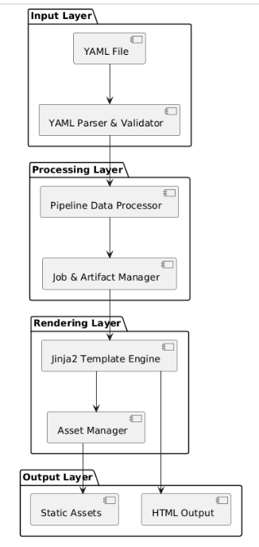

# Graphical Representation of Pipelines (GRP)Design Document

## Overview
The Graphical Representation of Pipelines (GRP) project aims to create a visual representation of CI/CD pipeline configuration files. This feature is designed to enhance the understanding of pipeline structures and job dependencies, similar to the graphical representation provided by GitLab.

## Objectives
- To develop a tool that can convert YAML pipeline configuration files into a graphical format.
- To ensure that the graphical representation accurately reflects the stages, jobs, and their dependencies.
- To provide a user-friendly interface for visualizing complex pipeline structures.

## Scope
### Included
- Development of a graphical representation tool that processes YAML files.
- Visualization of stages, jobs, dependencies, and artifacts.
- Support for dynamic updates based on changes in the YAML configuration.

### Excluded
- Integration with external CI/CD systems beyond the YAML input.
- Advanced interactive features beyond basic visualization.

## Requirements
### Functional Requirements
1. The tool must accept a valid YAML file as input.
2. The graphical output must display stages and jobs according to the YAML configuration.
3. Job dependencies must be represented as arrows connecting the relevant job graphics.
4. Artifacts must be displayed in a separate graphical object, showing filesystem paths and regular expressions.

### Non-Functional Requirements
1. The tool should be user-friendly and intuitive.
2. The graphical representation must be responsive and visually appealing.
3. The system should handle errors gracefully, providing meaningful feedback to users.

## Architecture
The system architecture consists of the following components:
- **Input Module**: Responsible for reading and validating the YAML configuration file.
- **Processing Module**: Parses the YAML data and prepares it for visualization.
- **Rendering Module**: Generates the graphical representation using HTML, CSS, JavaScript, and SVG.
- **Output Module**: Exports the graphical representation in the desired format.

## System Architecture Diagram




## Core Technologies

### 1. Python (^3.12)
- **Purpose**: Main programming language for backend processing and CLI tool development
- **Rationale**:
   - Strong ecosystem for YAML processing and web templating
   - Excellent cross-platform compatibility
   - Rich library support for CI/CD tooling

### 2. YAML Processing
- **Technology**: PyYAML (^6.0.2)
- **Purpose**: Parse and validate CI/CD pipeline configurations
- **Rationale**:
   - De facto standard for YAML processing in Python
   - Robust parsing capabilities
   - Well-maintained and documented

### 3. Template Engine
- **Technology**: Jinja2 (^3.1.4)
- **Purpose**: Generate HTML visualizations from pipeline data
- **Rationale**:
   - Python's most popular templating engine
   - Excellent integration with web frameworks
   - Powerful macro and inheritance features

## Development Tools

### 1. Package Management
- **Technology**: Poetry
- **Purpose**: Dependency management and packaging
- **Rationale**:
   - Modern dependency resolution
   - Reproducible builds
   - Integrated virtual environment management

### 2. Testing Framework
- **Technologies**:
   - pytest (^7.4.4)
   - pytest-cov (^4.0.0)
   - Selenium (^4.26.1)
- **Purpose**: Unit testing, coverage reporting, and UI testing
- **Rationale**:
   - pytest: Modern features and excellent plugin ecosystem
   - Selenium: Industry standard for web testing

### 3. Code Quality Tools
- **Technologies**:
   - black (^24.10.0)
   - flake8 (^6.0.0)
   - nox (^2024.4.15)
- **Purpose**: Code formatting, linting, and automation
- **Rationale**:
   - Black: Deterministic formatting
   - flake8: Comprehensive linting
   - nox: Flexible test automation

### 4. Documentation and Syntax Highlighting
- **Technology**: Pygments (^2.17.2)
- **Purpose**: Syntax highlighting for YAML content
- **Rationale**:
   - Industry standard for syntax highlighting
   - Extensive language support
   - Easy integration with web output


## Project Structure
## Code Structure
```
├── main
│   ├── src
│   └── t5_grp
│       ├── assets
│       │   ├── main.css
│       │   └── main.js
│       ├── main.py
│       ├── parser
│       │   └── yaml_parser.py
│       ├── templates
│       │   └── pipeline_template.html
│       └── visualization
│           └── diagram_generator.py
└── tests
├── parser
│   └── test_yaml_parser.py
├── test_files
│   ├── invalid.yaml
│   └── valid.yaml
├── test_main.py
└── visualization
└── test_diagram_generator.py
```

## Component Description

### Main Components
1. **Parser Module**
    - Handles YAML file parsing and validation
    - Converts YAML to internal data structure

2. **Visualization Module**
    - Generates HTML/SVG visualization
    - Manages job dependencies and artifacts
    - Handles asset management

3. **Templates**
    - Contains Jinja2 templates for HTML generation
    - Defines visualization layout and structure

4. **Assets**
    - CSS for styling
    - JavaScript for interactivity
    - Static resources

### Test Structure
- Unit tests for each module
- Test files for validation
- Integration tests for full pipeline

## Key Files
- `main.py`: Application entry point and CLI
- `yaml_parser.py`: YAML configuration parser
- `diagram_generator.py`: Visualization generator
- `pipeline_template.html`: Main visualization template


Reference Information
Gitlab:https://docs.gitlab.com/ee/ci/pipelines/
