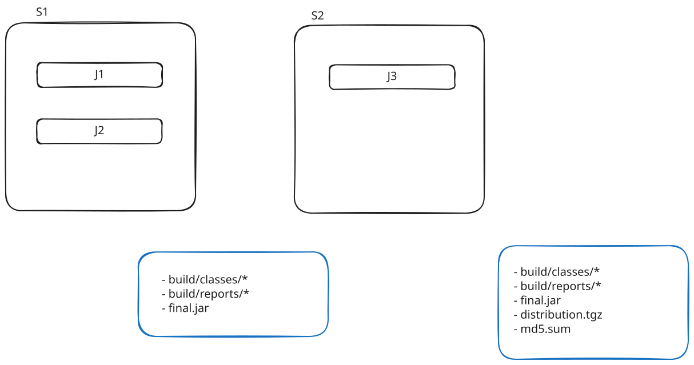

# Graphical Representation of Pipelines (GRP)

The goal of this feature is to add the ability to represent a pipeline
Configuration file as a graphic. The feature is similar to the GitLab
feature that creates an image of your GitLab pipeline.


## Inputs and Outputs 

### YAML input 

The input to the program must be a YAML file. This can be the configuration file itself or the output of the `--dry-run` option of the CI/CD command that is also assumed to be in the YAML format. 

The YAML input is required to be 

1. valid YAML 
1. use the keys defined by the CI/CD requirements 

Any extra YAML keys that are found in the YAML file are **not** processed by the graphical representation program.


### Output 

For now you are free to choose the output format for the graphical representation. This requirement might change as the project progresses. 

## Graphical components 

### Stages 

A stage should show up as a graphical object. The stage object must be labeled with the stage name. 


### Stage order 

The GRP **must** place the stages in the order that are going to be executed. On the graphic the order **must** be starting from the left and going to the right. 


### Jobs 

A job should show up on the image **inside** the stage object in the graphic. The job must be assigned to the correct stage per the YAML input. 

The job graphic object **must** contain the following information in the graphic 

* the job name as text 
* a visual marker based on whether the job allows failure, e.g., 
    * if the job does *not* allow failures then the job's graphical object has a solid white background color. 
    * if the job *does* allow failure, then the job's graphical object has a light gray background color. 

### Job dependencies 

A job's dependencies are shown on the graphic as an arrow. The arrow's base starts job's graphical object that is the dependency and the arrow's head points to the job that has declared the dependency. 

For example 

```yaml

job: 
    name: main 
    stage: s1 
    needs: ["sort"]
    # more job specific keys here elided 

job: 
    name: sort
    stage: s1
    # more job specific keys here elided 
```

The arrow must start at the object that represents the job named `sort` and point to the object that represents the job named `main`

### Artifacts 

Artifacts **must** be displayed in a separate graphical object from jobs and stages. An Artifacts graphical object **must** contain the filesystem paths and regular expressions as they appear in the input YAML file. These paths and regular expression must be inside the Artifacts graphical object. 

The Artifacts graphical object must appear **between** the appropriate stage artifact objects that are relevant. 

For example, consider a pipeline with 

* 2 stages, stage `S1` and `S2`
* Stage `S1` has 
    * Job `J1` that pushed artifacts with the paths 
        * `build/clases/*`
        * `build/reports/*`
    * Job `J2` that pushed artifacts with the paths 
        * `final.jar`
* Stage `S2` has 
    * Job `J3` that pushed artifacts with the paths 
        * `distribution.tgz`
        * `md5.sum`

Then the image must have 

1. At artifacts graphical object **between and below** stage `S1` and `S2` that has **all** the paths from **all** jobs in stage `S1` 
1. At artifacts graphical object **at the end and below** `S2` that has **all** the paths from **all** jobs in stage `S1` **and all** the paths from **all** the jobs in stage `S2`. 

Here is a skeleton diagram to give you an idea. 



## Positioning 

### Stages 

All stages must be **top** aligned and must have equally distributed on the x-axis. 


### Jobs 

All jobs within a stage must be **center** aligned and must be equally distributed on the y-axis. 


### Arrows 

The program must do its best to position arrows (straight or curved) so that **no arrow overlaps with any other component**. When that is not possible the arrow should be placed so that we have the minimum amount of overlap between the arrow and other graphical components. 